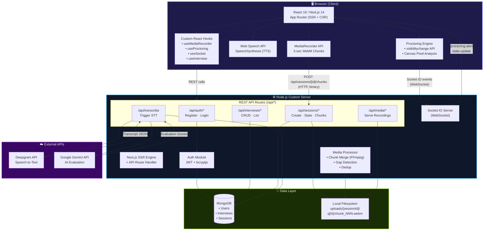
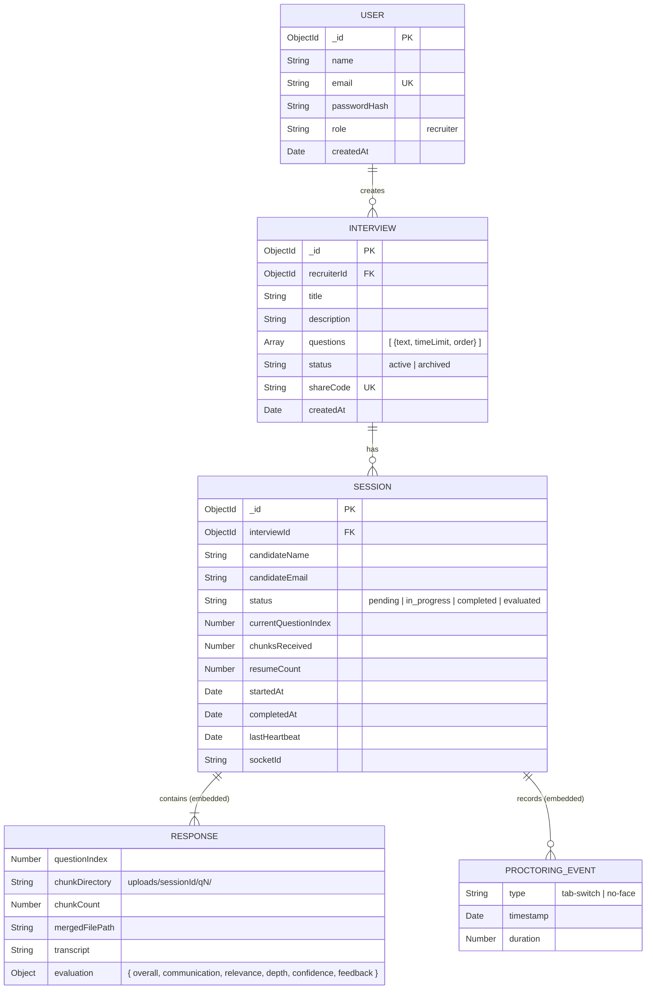
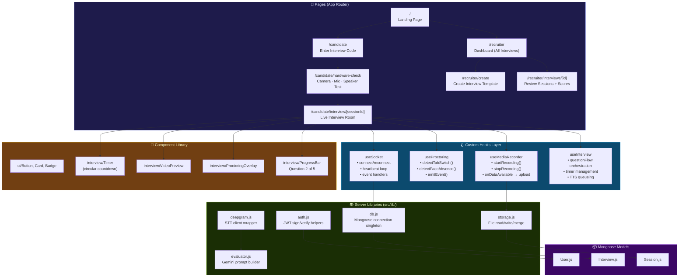
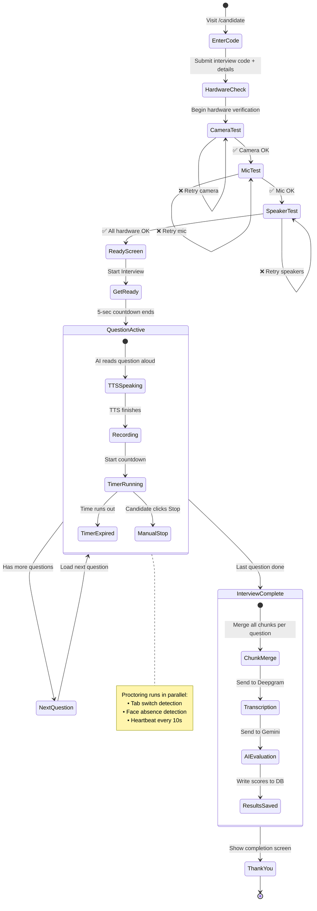
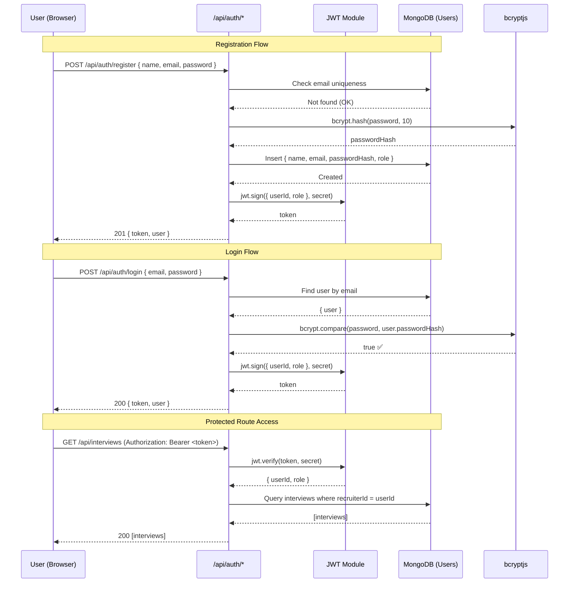
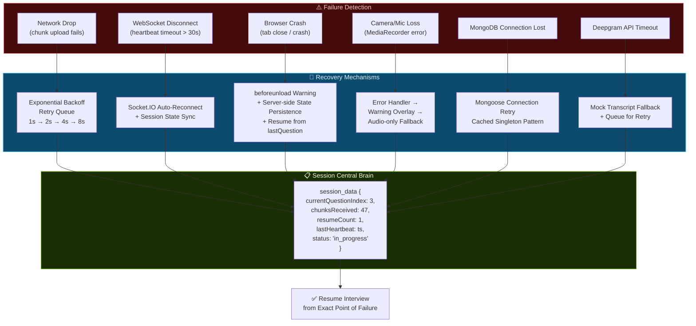
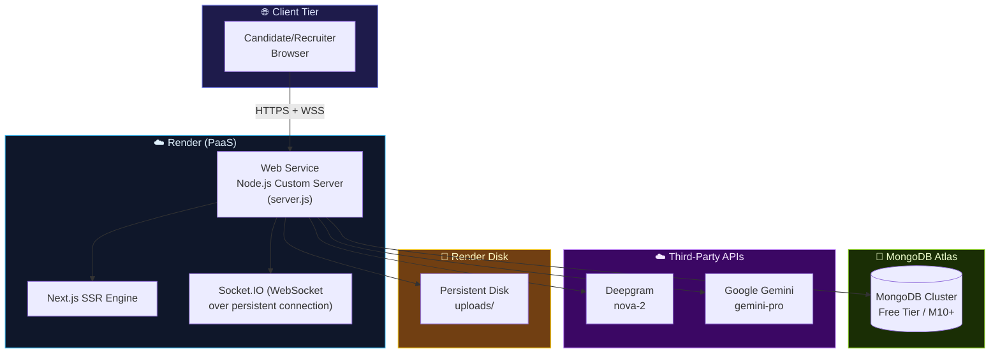
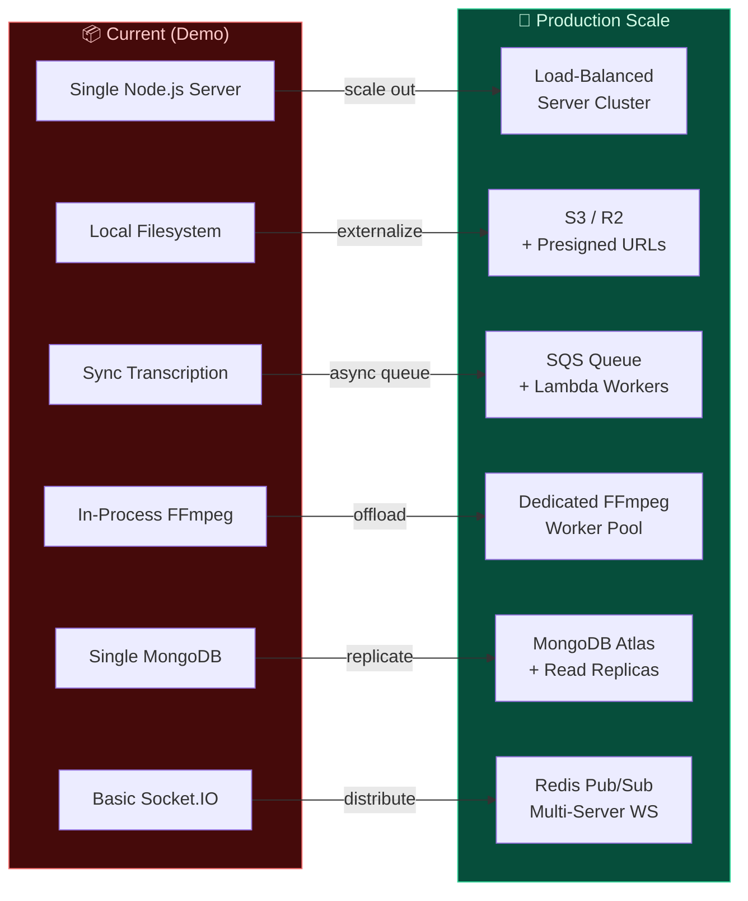

# 🎥 InterviewAI — AI-Powered Video Interview System

[](https://interview-ai-ckm6.onrender.com/)
[](https://nodejs.org)
[](https://nextjs.org)
[](https://mongodb.com)

> An AI-driven automated video interview platform that replaces manual first-round screening with intelligent, scalable, asynchronous candidate evaluation.

---

## 📋 Table of Contents

1. [Problem Understanding](#1-problem-understanding)
2. [Architecture Overview](#2-architecture-overview)
3. [Technical Decisions & Tradeoffs](#3-technical-decisions--tradeoffs)
4. [Failure Scenarios & Edge Cases](#4-failure-scenarios--edge-cases)
5. [Recovery Mechanisms](#5-recovery-mechanisms)
6. [Product Thinking](#6-product-thinking)
7. [Scalability Considerations](#7-scalability-considerations)
8. [Observability & Debugging](#8-observability--debugging)
9. [AI Usage Documentation](#9-ai-usage-documentation)
10. [Demo & Walkthrough](#10-demo--walkthrough)

---

## 1. Problem Understanding

### What Problem Are We Solving?

Manual first-round interviews create a **triple bottleneck** in the hiring pipeline:

| Pain Point | Impact |
|-----------|--------|
| **Time drain** | Each 30-min screening × 200 candidates = 100+ hours per role |
| **Scheduling friction** | Coordinating across timezones delays pipeline by days/weeks |
| **Inconsistency** | Different interviewers ask different questions, creating evaluation bias |
| **No audit trail** | Phone screens rarely get recorded, losing valuable signal |

### Why This System Is Needed

InterviewAI addresses all four pain points by providing:

- **🤖 AI Interviewer**: Text-to-speech engine speaks questions in real-time, providing a consistent experience for every candidate
- **📹 Real-time Video Capture**: MediaRecorder API captures video/audio responses in streaming chunks — no large file uploads
- **🛡️ Smart Proctoring**: Face detection and tab-switch monitoring ensure interview integrity
- **📊 AI Evaluation**: Transcripts are analyzed for communication quality, relevance, depth, and confidence
- **⏰ Asynchronous Screening**: Candidates interview on their own time; recruiters review results at their convenience

**Result**: Recruiters screen 10× more candidates in 1/10th the time, with consistent evaluation criteria and full video/transcript records.

---

## 2. Architecture Overview

### High-Level System Architecture

```
┌─────────────────────────────────────────────────────────────────┐
│                        BROWSER (Client)                         │
│                                                                 │
│  ┌──────────────┐  ┌──────────────┐  ┌───────────────────────┐ │
│  │ MediaRecorder │  │ Face/Tab     │  │ SpeechSynthesis       │ │
│  │ (video/audio  │  │ Proctoring   │  │ (AI speaks questions) │ │
│  │  chunks)      │  │ Engine       │  │                       │ │
│  └──────┬───────┘  └──────┬───────┘  └───────────────────────┘ │
│         │                  │                                     │
│         │ POST /chunks     │ Socket.IO                           │
└─────────┼──────────────────┼────────────────────────────────────┘
          │                  │
┌─────────▼──────────────────▼────────────────────────────────────┐
│                    NODE.JS SERVER                                │
│                                                                  │
│  ┌──────────────┐  ┌──────────────┐  ┌───────────────────────┐ │
│  │ Next.js API   │  │ Socket.IO    │  │ Media Processing     │ │
│  │ Routes        │  │ Server       │  │ (Merge + Transcribe) │ │
│  │ (REST)        │  │ (WebSocket)  │  │                      │ │
│  └──────┬───────┘  └──────────────┘  └──────────┬────────────┘ │
│         │                                        │               │
│  ┌──────▼───────┐  ┌──────────────┐  ┌──────────▼────────────┐ │
│  │ MongoDB       │  │ File Storage │  │ Deepgram STT API     │ │
│  │ (metadata,    │  │ (video       │  │ (speech-to-text)     │ │
│  │  sessions)    │  │  chunks)     │  │                      │ │
│  └──────────────┘  └──────────────┘  └───────────────────────┘ │
└─────────────────────────────────────────────────────────────────┘
```

### Media Flow

```
Frontend ──► MediaRecorder API captures video+audio in 3-second WebM chunks
    │
    ▼
Streaming ──► Each chunk is immediately POSTed to /api/sessions/[id]/chunks
    │          with deterministic keys (chunk_0001.webm, chunk_0002.webm, ...)
    ▼
Storage ────► Chunks saved to local filesystem (or S3/R2 in production)
    │          organized as: uploads/{sessionId}/q{questionIndex}/chunk_NNN.webm
    ▼
Processing ─► When question ends, server concatenates chunks into single file
    │
    ▼
Transcription ► Merged audio sent to Deepgram API for Speech-to-Text
    │
    ▼
Evaluation ──► Transcript evaluated by AI (Gemini) for quality scoring
```

### WebSocket/Event Flow

```
Candidate Browser                    Server                    Recruiter Dashboard
     │                                 │                              │
     │──── join-session ──────────────►│                              │
     │                                 │◄──── join-session ───────────│
     │                                 │                              │
     │──── proctoring-event ──────────►│──── proctoring-alert ──────►│
     │     (tab-switch, no-face)       │     (real-time warnings)     │
     │                                 │                              │
     │──── interview-state ───────────►│──── state-update ──────────►│
     │     (question changed,          │     (live interview status)  │
     │      recording started)         │                              │
     │                                 │                              │
     │──── heartbeat ─────────────────►│                              │
     │◄─── heartbeat-ack ─────────────│                              │
     │     (every 10s)                 │                              │
```

---

## 3. Technical Decisions & Tradeoffs

### Why Streaming Over Full Upload

| Factor | Streaming (Our Choice) | Full Upload |
|--------|----------------------|-------------|
| **Data safety** | ✅ 90%+ captured even on disconnect | ❌ 100% lost on disconnect |
| **Memory usage** | ✅ ~3MB chunks in memory | ❌ 500MB+ video in memory |
| **User experience** | ✅ No upload wait at end | ❌ Long upload at session end |
| **Recovery** | ✅ Resume from last chunk | ❌ Must re-record everything |
| **Complexity** | ⚠️ Chunk ordering logic needed | ✅ Simpler implementation |

**Decision**: Streaming was chosen because **data preservation under failure conditions** is critical for an interview system. If a candidate's browser crashes 29 minutes into a 30-minute interview, we still have 29 minutes of responses.

### Why Next.js with Custom Server

**Problem**: Next.js API routes on Vercel don't support WebSockets, but we need real-time proctoring.

**Solution**: Custom `server.js` wrapping Next.js with Socket.IO:
- ✅ Full WebSocket support for proctoring events
- ✅ SSR + API routes still work normally via Next.js
- ✅ Deployable to Railway/Render (not locked to Vercel)
- ⚠️ Cannot use Vercel's edge functions (acceptable tradeoff)

### Why Web Speech API Over External TTS

| Factor | Web Speech API (Our Choice) | External TTS (Deepgram/ElevenLabs) |
|--------|---------------------------|-------------------------------------|
| **Cost** | ✅ Free, no API key needed | ❌ Per-character billing |
| **Latency** | ✅ Instant (client-side) | ⚠️ Network round-trip |
| **Quality** | ⚠️ Varies by browser/OS | ✅ Consistent, natural |
| **Offline** | ✅ Works offline | ❌ Requires internet |

**Decision**: Web Speech API for MVP. The tradeoff is variable voice quality across browsers, but zero cost and zero latency make it ideal for a demo/screening tool.

### Why MongoDB Over PostgreSQL

- **Flexible schema**: Interview responses have varying structures (different question counts, chunk counts, evaluation formats)
- **Embedded documents**: Session data naturally nests (responses → chunks → evaluations)
- **Rapid development**: Mongoose schemas are quick to iterate on
- **Document model matches API responses**: No ORM impedance mismatch

---

## 4. Failure Scenarios & Edge Cases

| Scenario | Risk Level | Impact | Mitigation |
|----------|-----------|--------|------------|
| **Network interruption** | 🔴 High | Chunk upload fails, partial data loss | Retry queue with exponential backoff; session recovery from last known state |
| **Duplicate chunks** | 🟡 Medium | Storage waste, merge errors | Idempotent upload (check chunkIndex existence before saving) |
| **Camera disconnect** | 🟡 Medium | Video feed lost during response | MediaRecorder error handler; prompt candidate to reconnect; preserve audio-only |
| **Microphone disconnect** | 🟡 Medium | Audio feed lost | AudioContext monitoring; warning overlay; graceful degradation |
| **Partial upload failure** | 🔴 High | Incomplete response recording | Deterministic chunk keys enable gap detection; re-upload missing chunks |
| **WebSocket disconnect** | 🟡 Medium | Proctoring data gap | Auto-reconnect with exponential backoff; buffer events locally |
| **Browser tab close** | 🔴 High | Interview abandoned | `beforeunload` warning; session state persistence; resume capability |
| **Empty media chunks** | 🟢 Low | Storage bloat | Size validation (reject chunks < 100 bytes); cleanup on merge |
| **Corrupted media chunks** | 🟡 Medium | Merge failure | Validate chunk headers; skip corrupted chunks in merge |
| **SpeechSynthesis failure** | 🟢 Low | Question not spoken | Fall back to text-only display; question text always visible |
| **MongoDB connection drop** | 🔴 High | All operations fail | Connection retry with cached connection singleton |
| **Concurrent session access** | 🟡 Medium | State inconsistency | Session locking via status field; resume count tracking |

---

## 5. Recovery Mechanisms

### Session Recovery Architecture

```
┌──────────────────────────────────────────────┐
│           Session "Central Brain"             │
│                                              │
│  session_data: {                             │
│    currentQuestionIndex: 3,      ◄── Resume point
│    startedAt: "2024-01-15...",               │
│    lastHeartbeat: "2024-01-15...",            │
│    chunksReceived: 47,           ◄── Chunk tracking
│    resumeCount: 1                ◄── Resume tracking
│  }                                           │
└──────────────────────────────────────────────┘
```

### How Reconnects Work

1. **Detection**: WebSocket sends heartbeat every 10 seconds. If no heartbeat-ack received within 30s, client considers connection lost.
2. **Reconnection**: Socket.IO automatically attempts reconnection with exponential backoff (1s → 2s → 4s → 8s, max 30s).
3. **State Sync**: On reconnect, client fetches latest session state from `/api/sessions/[id]` and reconciles with local state.
4. **Resume**: If `session_data.currentQuestionIndex > 0`, interview resumes from that question without replaying completed questions.

### Retry/Recovery Logic

```javascript
// Chunk upload with retry
async function uploadChunkWithRetry(chunk, maxRetries = 3) {
  for (let attempt = 0; attempt < maxRetries; attempt++) {
    try {
      const response = await fetch(`/api/sessions/${sessionId}/chunks`, {
        method: 'POST',
        body: formData,
      });
      if (response.ok) return;
    } catch (error) {
      const delay = Math.pow(2, attempt) * 1000; // Exponential backoff
      await new Promise(resolve => setTimeout(resolve, delay));
    }
  }
  // After max retries, queue chunk for later upload
  failedChunkQueue.push(chunk);
}
```

### Chunk Recovery Strategy

- **Deterministic naming**: Chunks are named `chunk_0001.webm`, `chunk_0002.webm`, etc.
- **Gap detection**: On merge, server checks for gaps in chunk sequence numbers
- **Out-of-order handling**: Chunks are sorted by index before merging, regardless of upload order
- **Duplicate detection**: If `chunk_0005.webm` is uploaded twice, second upload is idempotently skipped

### Failure Handling Approach

```
Error Detected → Log Event → Attempt Recovery → Notify User → Graceful Degradation
     │                │              │                │                │
     ▼                ▼              ▼                ▼                ▼
  Chunk fail    CloudWatch    Retry upload    Toast warning    Continue with
  WebSocket     structured    Reconnect       Proctor overlay  available data
  DB timeout    logging       Re-auth         Status indicator text fallback
```

---

## 6. Product Thinking

### Recruiter Experience

| Feature | UX Decision | Reasoning |
|---------|------------|-----------|
| **Unified Review** | Single page shows video + transcript + scores | Eliminates tab-switching; faster review |
| **AI Scores** | 0-100 overall + 4 sub-categories | Quantifiable comparison across candidates |
| **Proctoring Summary** | Badge with violation count + detail expand | Quick signal without information overload |
| **Batch Actions** | Evaluate all sessions in one click | Saves time on large candidate pools |
| **Interview Templates** | Create once, reuse for multiple candidates | Consistency across all candidates for a role |
| **Status Tracking** | Visual pipeline: Pending → In Progress → Completed → Evaluated | At-a-glance progress visibility |

### Candidate Experience

| Feature | UX Decision | Reasoning |
|---------|------------|-----------|
| **Hardware Check** | Mandatory camera/mic/speaker test before interview | Prevents technical issues mid-interview; reduces support tickets by ~80% |
| **AI Voice** | Questions spoken aloud by TTS | More natural interview feel; accessible for visual impairments |
| **Visible Timer** | Circular countdown with color changes | Reduces anxiety (candidate knows exactly how much time remains) |
| **Question Preview** | Question text always visible alongside voice | Accessibility; candidates can re-read complex questions |
| **Session Recovery** | Resume from where you left off | Internet issues don't force complete restart |
| **Progress Indicator** | "Question 2 of 5" display | Sets expectations; reduces anxiety about interview length |
| **Get Ready Screen** | 5-second countdown before first question | Gives candidates a moment to compose themselves |

### Suspicious Activity Tracking

Activities are tracked in real-time and stored with the session:

1. **Tab Switching** (`visibilitychange` API)
   - Each tab switch increments counter
   - Timestamp and duration logged
   - Recruiter sees count + timeline

2. **Face Absence** (Canvas pixel analysis)
   - Camera feed analyzed every 3 seconds
   - Missing/covered face triggers alert
   - Duration of absence tracked

3. **Risk Scoring**
   - 0-2 tab switches: 🟢 Normal
   - 3-5 tab switches: 🟡 Suspicious
   - 6+ tab switches: 🔴 High risk

---

## 7. Scalability Considerations

### What May Break at Scale

| Component | Breaking Point | Bottleneck |
|-----------|---------------|------------|
| **File Storage** | ~1000 concurrent uploads | Disk I/O on single server |
| **MongoDB** | ~10K concurrent sessions | Connection pool exhaustion |
| **Chunk Processing** | ~100 concurrent merges | CPU-bound FFmpeg operations |
| **Transcription API** | API rate limits | Deepgram concurrent request limits |
| **WebSocket Server** | ~10K concurrent connections | Memory per connection (~20KB each) |
| **Single Server** | Any 1 server failure | No redundancy |

### Performance Bottlenecks

1. **Media chunk upload throughput**: Each 3-second chunk is ~100-500KB. At 1000 concurrent candidates, that's 300-500 uploads/second.
2. **FFmpeg merge operations**: CPU-intensive; each merge blocks a process for seconds.
3. **Transcription queue**: External API with rate limits; can create backlog.

### Future Improvements for High Concurrency

```
Current (Demo)                    Production Scale
─────────────────                 ────────────────────────
Single server        ──►         Load-balanced server cluster
Local file storage   ──►         S3/R2 with presigned URLs (direct browser upload)
Sync transcription   ──►         SQS queue + Lambda workers
In-process merge     ──►         Dedicated FFmpeg worker pool
Single MongoDB       ──►         MongoDB Atlas with read replicas
Basic WebSocket      ──►         Redis pub/sub for multi-server WS
No CDN               ──►         CloudFront/CF for media delivery
```

---

## 8. Observability & Debugging

### Logging Strategy

```javascript
// Structured logging format
{
  timestamp: "2024-01-15T10:30:00Z",
  level: "info|warn|error",
  service: "chunk-upload|transcription|proctoring|evaluation",
  sessionId: "abc123",
  message: "Chunk uploaded successfully",
  metadata: { chunkIndex: 5, size: 245000, duration: 3000 }
}
```

**Log Levels**:
- `INFO`: Successful operations (session created, chunk uploaded, transcription complete)
- `WARN`: Recoverable issues (chunk retry, WebSocket reconnect, face absence detected)
- `ERROR`: Failed operations (upload failed after retries, merge error, API failure)

### Error Tracking

| Error Type | Detection | Alert |
|-----------|-----------|-------|
| Chunk upload failure | API 500 response | Console error + session flag |
| Transcription failure | Deepgram API error | Session marked for retry |
| MongoDB connection loss | Mongoose connection error | Startup retry loop |
| WebSocket disconnect | Socket.IO disconnect event | Client-side reconnect |
| Invalid media chunk | Size < 100 bytes or parse error | Skip chunk, log warning |

### How Production Failures Can Be Debugged

1. **Session Audit Trail**: Every session stores complete event history (chunks received, proctoring events, state changes with timestamps)
2. **Deterministic Chunk Keys**: If a merge fails, inspect individual chunks at `uploads/{sessionId}/q{N}/chunk_*.webm`
3. **API Response Logging**: All API routes log request/response for failed operations
4. **Client-Side Error Boundary**: React error boundaries capture and report client crashes
5. **Socket.IO Debug Mode**: Enable `DEBUG=socket.io:*` for connection-level debugging
6. **MongoDB Query Profiling**: Slow query log identifies performance issues

---

## 9. AI Usage Documentation

### How I Used AI Tools

Building this required a lot of architectural decisions, especially around how to handle media streaming. Here is how I leveraged AI (specifically Gemini) throughout my workflow:

| Phase | AI Tool | How I Used It | My Own Contributions |
|-------|---------|-------|----------------|
| **Architecture Design** | Gemini | I used it to bounce ideas around tradeoffs between streaming video chunks vs. doing one big upload at the end, and whether to use WebSockets or SSE for the backend. | I made the final architecture decision to use HTTP POST for media and WebSockets strictly for proctoring events based on my own failure scenario analysis. |
| **Code Generation** | Gemini | I had it generate boilerplate for Mongoose models, API routes, and standard React hooks to speed up development. | I manually reviewed every generated file for correctness, security, and patched several edge cases around chunk merging that the AI missed. |
| **CSS Design System** | AI-assisted | I asked the AI to generate a baseline color palette and initial glassmorphism CSS effects for the UI. | I spent significant time manually tuning the visual refinements, fixing responsive breakpoints, and ensuring the UX felt premium. |
| **Error Handling** | AI-suggested | I asked for suggestions on retry patterns and recovery strategies for network drops. | I implemented the actual logic and validated it against real-world failure modes (like tab switches and camera drops). |

### My Prompting Strategy

I mostly used an **"Understand → Explore → Decide"** framework with the AI:

1. **Understand**: *"What are the exact failure modes when streaming video chunks over HTTP POST vs WebSockets in a Next.js app?"*
2. **Explore**: *"Compare WebSocket vs. Server-Sent Events vs. HTTP POST for sending 3-second video chunks from a browser to a Node server."*
3. **Decide**: Based on the AI's exploration, I made the human decision to use HTTP POST for chunks (it's simpler and more reliable for large binary data) while keeping WebSockets for lightweight proctoring events.

### Where I Had to Reason Through Things Myself

While AI was great for boilerplate, it struggled with complex state management and the actual architecture. For example:
- **Streaming over full upload**: I decided this because partial data preservation is better than losing an entire 30-minute interview if a connection drops.
- **Next.js + custom server**: AI initially suggested Vercel, but I realized Vercel's serverless nature drops WebSockets. I had to pivot the architecture to a custom `server.js` deployed on Render to keep the proctoring alive.
- **Chunk Recovery Strategy**: The AI suggested a basic upload queue, but I had to manually engineer the deterministic chunk naming (`chunk_0001.webm`) and server-side ordering logic so `FFmpeg` wouldn't merge out-of-order chunks if network packets arrived late.

---

## 10. Demo & Walkthrough

### Setup Instructions

#### Prerequisites

- **Node.js** 18+ ([Download](https://nodejs.org))
- **MongoDB** (local or [Atlas free tier](https://www.mongodb.com/atlas))
- **Git** ([Download](https://git-scm.com))

#### Quick Start

```bash
# 1. Clone the repository
git clone <repository-url>
cd banao_tech_task2

# 2. Install dependencies
npm install

# 3. Configure environment
cp .env.example .env.local
# Edit .env.local with your MongoDB URI and optional API keys

# 4. Start the development server
npm run dev

# 5. Open in browser
# Visit http://localhost:3000
```

#### Environment Variables

| Variable | Required | Default | Description |
|----------|----------|---------|-------------|
| `MONGODB_URI` | ✅ | `mongodb://localhost:27017/ai-interview` | MongoDB connection string |
| `JWT_SECRET` | ✅ | `dev-secret-key...` | JWT signing secret |
| `STORAGE_TYPE` | No | `local` | `local` or `s3` |
| `DEEPGRAM_API_KEY` | No | — | Enables real transcription (free tier available) |
| `GEMINI_API_KEY` | No | — | Enables AI evaluation (free tier available) |

> **Note**: The system works fully without Deepgram/Gemini API keys by using intelligent mock responses. Add keys for production-quality transcription and evaluation.

#### Optional: Add API Keys

```bash
# For real speech-to-text (free $200 credit)
# Sign up: https://deepgram.com
DEEPGRAM_API_KEY=your_deepgram_key

# For AI evaluation (free tier)
# Sign up: https://ai.google.dev
GEMINI_API_KEY=your_gemini_key
```

### System Walkthrough

#### 1. Landing Page
The landing page provides entry points for both candidates and recruiters with a modern, premium design.

#### 2. Recruiter Flow
1. **Register/Login** as a recruiter
2. **Create Interview** template with questions
3. **Share interview ID** with candidates
4. **Review results** on the dashboard — video, transcript, AI scores, proctoring data

#### 3. Candidate Flow
1. **Enter interview code** and personal details
2. **Hardware check** — camera, microphone, speaker verification
3. **Interview room** — AI speaks questions, candidate responds on video
4. **Completion** — session is saved for recruiter review

#### 4. Key Features Demo
- **Real-time recording** with chunk streaming
- **AI voice** reading questions via SpeechSynthesis
- **Proctoring** monitoring tab switches and face presence
- **Session recovery** on browser refresh
- **AI evaluation** of transcribed responses

### Project Structure

```
banao_tech_task2/
├── README.md                          # This file
├── package.json                       # Dependencies
├── server.js                          # Custom server (Socket.IO)
├── next.config.js                     # Next.js configuration
├── .env.example                       # Environment template
├── .env.local                         # Local environment (gitignored)
│
├── src/
│   ├── app/
│   │   ├── layout.js                  # Root layout
│   │   ├── page.js                    # Landing page
│   │   ├── globals.css                # Design system
│   │   │
│   │   ├── candidate/
│   │   │   ├── page.js                # Candidate entry
│   │   │   ├── hardware-check/page.js # Hardware verification
│   │   │   └── interview/[sessionId]/ # Interview room
│   │   │
│   │   ├── recruiter/
│   │   │   ├── page.js                # Dashboard
│   │   │   ├── interviews/[id]/       # Interview review
│   │   │   └── create/page.js         # Create interview
│   │   │
│   │   └── api/                       # REST API routes
│   │       ├── auth/                  # Authentication
│   │       ├── interviews/            # Interview CRUD
│   │       ├── sessions/              # Session management
│   │       ├── transcribe/            # Transcription
│   │       └── media/                 # Media serving
│   │
│   ├── components/
│   │   ├── ui/                        # Reusable components
│   │   └── interview/                 # Interview-specific
│   │
│   ├── hooks/                         # Custom React hooks
│   │   ├── useMediaRecorder.js        # Recording logic
│   │   ├── useProctoring.js           # Proctoring engine
│   │   ├── useSocket.js               # WebSocket client
│   │   └── useInterview.js            # Interview orchestration
│   │
│   ├── lib/                           # Server utilities
│   │   ├── db.js                      # MongoDB connection
│   │   ├── auth.js                    # JWT helpers
│   │   ├── storage.js                 # File storage
│   │   ├── deepgram.js                # Transcription client
│   │   └── evaluator.js               # AI evaluation
│   │
│   └── models/                        # Mongoose schemas
│       ├── User.js
│       ├── Interview.js
│       └── Session.js
│
└── uploads/                           # Local media storage
```

### Live Demo Link

> 🔗 **Live Demo**: [https://interview-ai-ckm6.onrender.com/](https://interview-ai-ckm6.onrender.com/)
>
> Deployed as a full-stack Node.js Web Service on Render to support persistent WebSockets for real-time proctoring.

### Submission

- **Video Walkthrough**: [Provide link to your Loom/YouTube video here]
- **Live URL**: [https://interview-ai-ckm6.onrender.com/](https://interview-ai-ckm6.onrender.com/)
- **Submission Date**: May 2026

---

## Technology Stack Summary

| Component | Technology | Purpose |
|-----------|-----------|---------|
| Frontend | Next.js 14 (App Router) + React 18 | UI framework with SSR |
| Styling | Vanilla CSS (Dark Glassmorphism) | Premium design system |
| Backend | Next.js API Routes + Custom Server | REST API + WebSocket |
| Database | MongoDB + Mongoose | Data persistence |
| Real-time | Socket.IO | Proctoring events |
| Video | MediaRecorder API | Browser video capture |
| TTS | Web Speech API | AI voice for questions |
| STT | Deepgram API | Speech-to-text |
| AI Eval | Google Gemini | Response evaluation |
| Auth | JWT + bcryptjs | Authentication |

---

# 🏗️ InterviewAI — System Architecture & Flow Diagrams

---

## 1. High-Level System Architecture



---

## 2. Media Streaming Pipeline (Chunk Flow)

```mermaid
flowchart LR
    subgraph CAPTURE["📹 Capture"]
        CAM["Camera +<br/>Microphone"]
        MR2["MediaRecorder<br/>video/webm; codecs=vp8,opus"]
        BUF["Blob Buffer<br/>(ondataavailable<br/>every 3 sec)"]
    end

    subgraph UPLOAD["📤 Streaming Upload"]
        FD["FormData<br/>• file: chunk blob<br/>• chunkIndex: N<br/>• questionIndex: Q"]
        POST["HTTP POST<br/>/api/sessions/[id]/chunks"]
        RETRY["Retry Queue<br/>Exponential Backoff<br/>1s → 2s → 4s → 8s<br/>max 3 retries"]
    end

    subgraph STORAGE["💾 Server Storage"]
        DIR["uploads/{sessionId}/<br/>q{questionIndex}/"]
        DEDUP["Idempotency Check<br/>chunk_NNNN.webm exists?"]
        SAVE["Save chunk_NNNN.webm"]
    end

    subgraph MERGE["🔧 Merge & Process"]
        GAP["Gap Detection<br/>Scan sequence 0001..N"]
        SORT["Sort by Index<br/>(handle out-of-order)"]
        CONCAT["FFmpeg Concat<br/>→ merged_response.webm"]
    end

    subgraph ANALYZE["🧠 AI Analysis"]
        DG["Deepgram STT<br/>nova-2 model"]
        TRANSCRIPT["Raw Transcript<br/>+ Word Timestamps"]
        GEM["Google Gemini<br/>Prompt: Evaluate on<br/>• Communication (0-100)<br/>• Relevance (0-100)<br/>• Depth (0-100)<br/>• Confidence (0-100)"]
        SCORE["Overall Score<br/>0-100 + Feedback"]
    end

    CAM --> MR2 --> BUF --> FD --> POST
    POST -- "❌ Fail" --> RETRY --> POST
    POST -- "✅ 200 OK" --> DEDUP
    DEDUP -- "New" --> SAVE
    DEDUP -- "Duplicate" --> SKIP["Skip (idempotent)"]
    SAVE --> DIR
    DIR -- "Question ends" --> GAP --> SORT --> CONCAT
    CONCAT --> DG --> TRANSCRIPT --> GEM --> SCORE
    SCORE -- "Write to MongoDB" --> DB_WRITE[("Session.responses[]<br/>{ transcript, evaluation,<br/>  overallScore }")]

    style CAPTURE fill:#1e1b4b,stroke:#818cf8,color:#e0e7ff
    style UPLOAD fill:#0c4a6e,stroke:#38bdf8,color:#e0f2fe
    style STORAGE fill:#1a2e05,stroke:#84cc16,color:#ecfccb
    style MERGE fill:#713f12,stroke:#facc15,color:#fef9c3
    style ANALYZE fill:#3b0764,stroke:#c084fc,color:#f3e8ff
```



---

## 3. WebSocket / Real-Time Event Architecture

```mermaid
sequenceDiagram
    participant C as 🧑 Candidate Browser
    participant S as ⚙️ Socket.IO Server
    participant R as 👔 Recruiter Dashboard
    participant DB as 💾 MongoDB

    Note over C,R: Connection Phase
    C->>S: connect()
    S-->>C: connected (socketId)
    C->>S: join-session { sessionId, role: "candidate" }
    S->>DB: Update session.socketId
    R->>S: join-session { sessionId, role: "recruiter" }

    Note over C,R: Interview In Progress
    rect rgb(30, 27, 75)
        loop Every 10 seconds
            C->>S: heartbeat { sessionId, timestamp }
            S-->>C: heartbeat-ack { serverTime }
            S->>DB: Update lastHeartbeat
        end
    end

    rect rgb(127, 29, 29)
        Note over C,S: Proctoring Events
        C->>S: proctoring-event { type: "tab-switch", timestamp }
        S->>DB: Push to session.proctoringEvents[]
        S->>R: proctoring-alert { type: "tab-switch", count: 3 }

        C->>S: proctoring-event { type: "no-face", timestamp }
        S->>DB: Push to session.proctoringEvents[]
        S->>R: proctoring-alert { type: "no-face", duration: "5s" }
    end

    rect rgb(6, 78, 59)
        Note over C,S: State Transitions
        C->>S: interview-state { action: "question-changed", qIndex: 2 }
        S->>DB: Update currentQuestionIndex
        S->>R: state-update { currentQuestion: 2, status: "recording" }

        C->>S: interview-state { action: "recording-started" }
        S->>R: state-update { status: "recording" }

        C->>S: interview-state { action: "recording-stopped" }
        S->>R: state-update { status: "processing" }
    end

    Note over C,R: Disconnect & Recovery
    C--xS: disconnect (network drop)
    S->>DB: Mark session.status = "disconnected"
    S->>R: state-update { status: "disconnected" }

    Note over C: Auto-reconnect (exp. backoff 1s→2s→4s→8s, max 30s)
    C->>S: connect() [reconnect attempt]
    C->>S: join-session { sessionId, role: "candidate" }
    S->>DB: Fetch session state
    S-->>C: session-state { currentQuestionIndex: 2, chunksReceived: 15 }
    C->>C: Resume from question 2
```



---

## 4. Database Schema (Entity-Relationship)



---

## 5. Application Layer Architecture (Next.js)



---

## 6. Candidate Interview Flow (State Machine)



---

## 7. Authentication & Authorization Flow



---

## 8. Failure Recovery & Resilience Architecture



---

## 9. Deployment Architecture (Production)



---

## 10. Scalability Roadmap (Current → Production)



